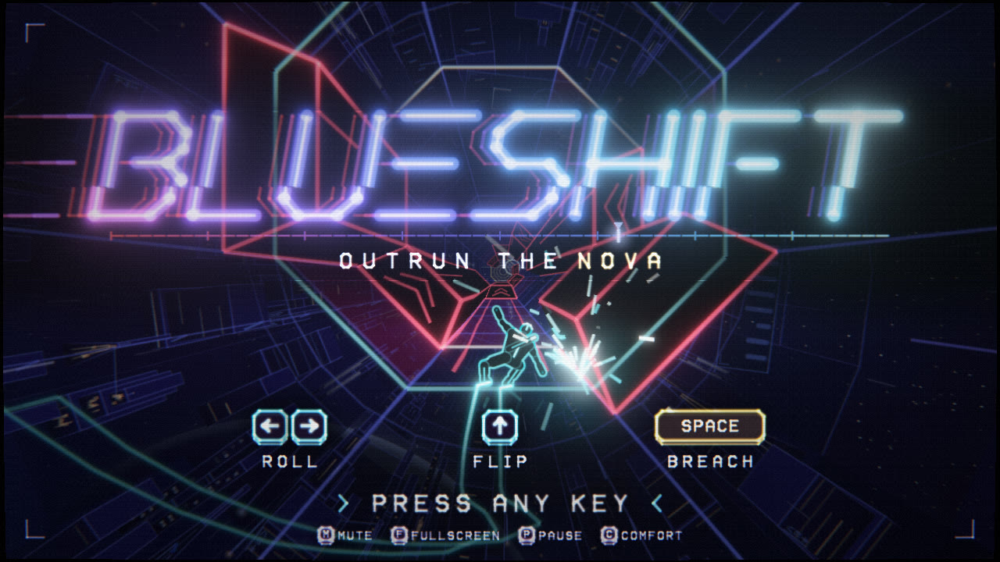
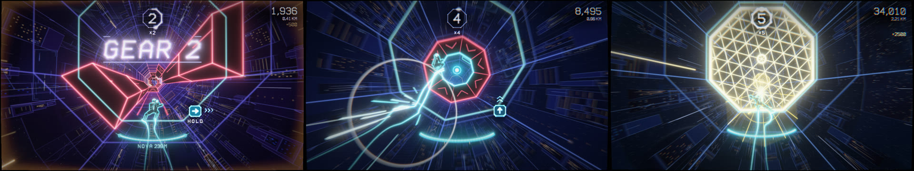

# BLUESHIFT

Outrun a supernova down the hollow middle of a neon space city. Spin the whole tunnel, flip gravity
through its core, punch through firewalls on the beat. Every wall you break makes the world bluer
and faster.




A browser game with its own engine: no libraries, no assets. Every picture is procedural geometry
and shaders, every sound and the whole soundtrack is synthesized at runtime.

## Play

In the browser: **https://adrianpartain59.github.io/blueshift/** (current Chrome, Edge, Firefox or
Safari; a keyboard, a gamepad or a phone held sideways).

Locally, nothing to install: build the single self-contained file and double-click it, or run the
dev server and open http://localhost:8790.

```bash
node tools/build.mjs      # -> dist/index.html
node tools/serve.mjs      # dev server on port 8790
```

| Input | Action |
|---|---|
| Left / Right, A / D | ROLL one lane around the tube (hold to repeat; hold against a fin to grind) |
| Up, W | FLIP through the core to the opposite lane (one Left/Right tap in mid-air shifts the landing) |
| Space, J, X, mouse click | BREACH: shatter yellow ICE. On the beat is PERFECT |
| P | pause / resume |
| Q / Esc | back: in a run the first press pauses and the second, from the pause screen, returns to the main menu; after a run it goes straight to the main menu |
| M | mute |
| F | fullscreen |
| C | comfort mode: no full-screen flashes, less shake, blur and aberration (remembered; on by default when the system asks for reduced motion) |

Touch: left / right thirds roll, centre-top flips, centre-bottom breaches, top-left corner pauses.
The pause screen has the comfort switch (bottom left) and MAIN MENU (bottom right); the results
screen has MAIN MENU too.
Gamepad: d-pad, bumpers or left stick roll, A / X breach, Y or stick-up flips, Start pauses, B goes
back to the main menu from the pause screen or the results, Back toggles comfort, any other button
starts.
Any key restarts, from 0.7 s after the nova catches you.

Magenta is solid: never touch it. Yellow is ICE: hit it. Cyan is you and everything safe. Crashing
never kills you; it costs gears, and the nova behind you is always coming. Speed is your health bar.

## How it is built

```
src/engine/   the engine: WebGL2 neon batch renderer with HDR bloom and a post stack (gfx.js),
              CPU-projected 3D camera (cam3d.js), vector font, particles, screen-feel toolkit (fx.js),
              Web Audio core, fixed-step loop, input, math
src/game/     the game: tempo map, patterns, level assembly, the deterministic simulation (sim.js),
              the planner bot, hazard renderer, city, courier, vfx, HUD, soundtrack, sound effects
tools/        build.mjs (bundles everything into one HTML file), serve.mjs, and three test tools
docs/         DESIGN.md (the game), ENGINE.md (the engine), ARCHITECTURE.md (module contracts),
              pitches/ (the concept pitches this design was chosen from)
dev/          standalone test pages for single modules, driven by a scripted mock game
```

The game is a table: 8 lanes plus the core, on a 16th-note grid. Collision is a mask lookup at the
moment a hazard arrives, so it is exact and frame-rate independent. The simulation has no DOM in it
and runs in node, which is how the bot proves generated levels are fair.

```bash
node tools/build.mjs                                   # -> dist/index.html (+ dist/artifact.html)
node tools/simtest.mjs fair 60 300                     # a perfect bot must never crash (60 seeds x 300 s)
node tools/simtest.mjs balance 30                      # survival by bot skill
node tools/rulestest.mjs                               # the rules, as scripted inputs and expected events
node tools/harness.mjs --page "/index.html?vol=0&seed=3&quick=1" --script tools/scripts/live_menu_test.mjs --timeout 240000
                                                       # real keys and a scripted gamepad: pause, main menu, retry
node tools/dist_check.mjs                              # the bundled file must play exactly like the dev modules
node tools/shots.mjs --page "/index.html?bot=1&seed=3" --times 1,5.6,9.6,12.5,18,31.5 --out out/game
                                                       # headless storyboard of a bot run -> out/game/sheet.png
node tools/audio_probe.mjs music --seconds 34 --timeline 0:0.25,15:0.5,22:0.75,30:1
                                                       # offline render of the soundtrack: loudness, clipping, spectrogram
```

URL parameters for testing: `?bot=1` (the bot plays), `&skill=0.9`, `&seed=7`, `&quick=1` (start at
the drop), `&vol=0` (full audio path, silent), `&mute=1` (no audio at all), `&manual=1` (no
real-time loop; drive it with `window.__stage.seek(seconds)`), `&device=touch` or `&device=gamepad`
(show that device's prompts).

The test tools need Google Chrome installed (they drive it headless over the DevTools protocol) and
node 22 or newer. Nothing to install.
